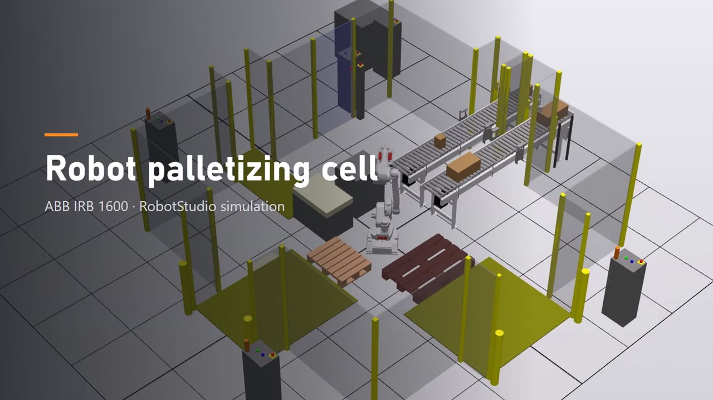

# Robot palletizing cell — ABB IRB 1600 · RobotStudio

Offline-programmed palletizing cell for two products, built in ABB RobotStudio as the group project of
*Industrial Robotics and Offline Programming* (PR310G) at the University of Skövde.

**Authors:** Peru Mendivil & Joaquín Moreno (Group 2)

▶ [Watch the simulation (54 s)](media/PalletProject_LinkedIn.mp4)

## What the cell does

One ABB IRB 1600-10/1.45 with a 6-cup vacuum gripper (one valve per cup) serves two conveyors:

- **Box 1** (500 × 250 × 200 mm, 2 kg) goes to a **Euro pallet**: 4-2 pattern, 2 layers, 12 boxes.
- **Box 2** (130 × 130 × 200 mm, 0.4 kg) is collected on a **stacking table** into a 3×2 block. The robot picks the
  whole block at once and places it on a **half pallet**: 4 blocks per layer, 3 layers, 72 boxes, with a cardboard
  **liner** on top of layers 1 and 2.
- When both conveyors have a box, the robot alternates the two products.
- A full pallet or an empty liner stack turns on a light and shows a message for the operator. The robot keeps
  working with the other product while the operator swaps the pallet from outside the fence. The operator buttons
  are read with interrupts (`TRAP`), so a short press is never lost.
- The cell has a safety fence, an interlocked door, emergency stops, light curtains with muting on the conveyor
  tunnels and safety mats at the pallet and liner access points.

The simulation uses RobotStudio smart components for the conveyors, the vacuum gripper (line sensors on the cups),
the liner stack and the removal of full pallets.

## Repository layout

| Path | Content |
|---|---|
| [`station/Pallet_Project.rspag`](station/) | **Final station** (Pack and Go): cell, smart components, safety equipment and virtual controller |
| [`rapid/`](rapid/) | **Final RAPID program**: `PalletProgram.mod` (logic), `CalibData.mod` (work objects, tool and loads) and `PalletProgramV1.pgf` |
| [`docs/`](docs/) | Project notes in Spanish: design decisions, measurements, tests and task list |
| [`media/`](media/) | Simulation video and progress recordings |
| [`history/rapid/`](history/rapid/) | Earlier versions of the program, kept for reference |
| [`tools/video/`](tools/video/) | Scripts used to edit the simulation video (ffmpeg + Python + Remotion) |

## How to open it

1. Install **ABB RobotStudio 2025** (the Pack and Go also opens in RobotStudio 2024.4). RobotWare 6.13.02 is needed for the virtual IRC5 controller.
2. *File → Open* → `station/Pallet_Project.rspag` → *Unpack & Work*.
3. *Simulation → Reset* to the saved state **`Inicio_04-11`** (empty pallets, full liner stack) and press **Play**.
4. When a pallet is full, open the properties of `SC_Conveyor1` (Euro pallet) or `SC_Conveyor2` (half pallet) and press
   `EuroPalletReplaced` / `HalfPalletReplaced`. The liner stack is refilled with `LinersRefilled` in `SC_Liners`.

The RAPID files in `rapid/` are the same ones that are inside the Pack and Go. To load them into another controller:
right-click `T_ROB1` → *Load Program* → `rapid/PalletProgramV1.pgf`.

## Program structure

- `Main` initialises the cup signals, the operator lights and the interrupts, and then decides each cycle which box
  to handle from the conveyor sensors, the full-pallet flags and the last box handled.
- `ProcessBox1`, `ProcessBox2` and `TransferStack` are finite-state machines for the place positions. Every position is
  computed with `Offs` from one base target per station.
- `ApproachPoint` performs every pick and place (approach, vacuum on/off and `GripLoad`), with the approach height
  given by `ApproachHeight(station)`.
- `CalibData.mod` holds the work objects, `toolVacuum` (4.7 kg estimated from the measured parts) and the payloads
  with their inertias. The payload stays within the IRB 1600-10 load and inertia limits using the
  *vertical wrist* load diagram, because the gripper always works vertically.
